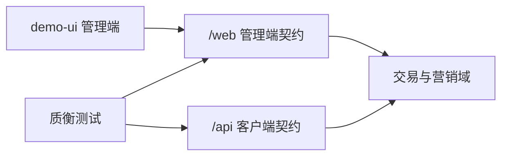

# 商城业务扩充路线图

本文档是 `qualitest-demo-mall` 的**业务与接口**长期清单。  
**主路径**：先增强已有交易域的可测深度，再按需补新域；始终保持可被质衡测到（双端 JWT、`@api.group`、场景种子、AI 提示）。  
C 端界面（小程序 / App / H5 等）**不是**本仓主交付；若有人要做，另见文末「可选：C 端客户端」。

按**小批次**落地：一次只盯一批，做完再翻下一批。表中「状态」取值：未开始 / 进行中 / 已完成。  
**当前批次**：`B1`（改这里即可，避免同时开多批）。

## 1. 定位与现状

### 1.1 定位

| 项 | 说明 |
|---|---|
| 仓库角色 | 质衡联调靶场（默认端口 `8801`，库 `qualitest-demo-mall`） |
| 管理端 | `/web/**` 等 + `demo-ui`（若依风格 CRUD / 场景控制台） |
| 客户端契约 | `/api/**` + 账号 JWT（`POST /api/account/auth/login` → `accountToken`） |
| 认证约定 | 管理端 Token 与客户端 Token **不可混用**；客户端从 Token 取 `accountId` |

### 1.2 已有业务域

- 账号：注册 / 登录 / 登出 / 资料 / 改密
- 收货地址、余额流水与模拟充值
- 优惠券领取、我的券、下单可用券
- 分类、商品 SPU/SKU、购物车
- 订单：preview / create / pay / cancel / confirmReceive
- 退款：preview / apply / my / cancel
- 进阶：RustFS 文件上传（`/api/file`）

场景种子见 `sql/seed/scenarios/manifest.json`（S01–S08 / F01–F12）；自然语言提示见 [ai-test-flow-prompts.md](./ai-test-flow-prompts.md)。

### 1.3 扩充方向（两手）

1. **增强已有域**（优先）：同一路径上加校验、状态、筛选、幂等与失败场景——测面立刻变厚，不必先开新表  
2. **补新域**（按需）：搜索、多渠道模拟支付、物流轨迹、评价等（见 §4）

## 1.4 分期切片（一次一批）

主路径按 B1→B6 顺序；**不要并行开两批**。标「穿插」的可在相关批里顺手做，或有空再补，不单独占一期。

| 批次 | 范围 | 本批要落地的点 | 合入标准（做完再翻下一批） | 状态 |
|---|---|---|---|---|
| B1 | 购物车闭环 | 同 SKU 合并、加购上限、失效行、勾选结算、`quantity=0` | 行为写死 + ≥3 条 S/F + AI 提示 | 未开始 |
| B2 | 商品可测 | 列表查询增强、详情字段、库存汇总、销量回写、分类停用；可选批量上下架 | 查询/一致性可断言 + ≥2 条场景 | 未开始 |
| B3 | 订单门禁 | 列表状态筛选、待付款改地址/留言、取消原因、已取消再付、确认收货门禁；可选运费/发货运单号 | 状态机门禁可测 + ≥3 条场景 | 未开始 |
| B4 | 优惠券 | 领取库存/名额、适用范围、我的券筛选、多券拒绝；可选占券超时释放 | 用券规则可负向断言 + ≥2 条场景 | 未开始 |
| B5 | 退款链 | 退货退款走通、原因枚举、拒绝后再申；可选凭证图、部分退后再退 | 更长状态链可复现 + ≥2 条场景 | 未开始 |
| B6 | 新域 P0 | 模拟支付渠道（支付单 + 成功/失败回调幂等） | 与 `pay_type` 1/2 对齐 + 回调幂等场景 | 未开始 |
| 穿插 | 账号 / 地址 / 余额 / 文件 | 登录失败细分、资料头像、改密旧 Token、地址上限与校验、余额筛选与充值边界、bizType 白名单、删除权限 | 不阻塞主批；跟相关故事一起或空档补 | 未开始 |
| 后置 | 新域 P1 / 选修 | 物流轨迹、商品评价；库存并发、超时关单、积分、运营台、统计 | B6 后再开；可与穿插并行 | 未开始 |

依赖关系：B1–B5 互不硬依赖，但建议按表序做（先客户端故事再售后）；B6 依赖订单支付路径已稳（B3 完成后更顺）；物流 / 评价依赖发货与确认收货（B3，可选运单号字段）。

## 2. 落地检查单

增强已有接口或新开域时，合入前建议核对下列项（可按实际删减）。本检查单是合入规范，不单独跟踪进度。

1. 表结构变更（若有；init SQL / 变更脚本）
2. `domain` 与业务内核（写操作不在两端 Controller 各写一份）
3. 管理端 / 客户端入出参与 API（含 `@api.group`）
4. 管理端薄页或动作按钮（可选）
5. seed 场景（成功 / 失败）与 `manifest.json`
6. [ai-test-flow-prompts.md](./ai-test-flow-prompts.md) 提示条目
7. Swagger 可测；必要时 README 一句说明

分层约定见仓库 Cursor 规则 `qualitest-demo-mall-backend`。

## 3. 已有能力增强（优先）

下列都挂在**现有表与 `/api`、`/web` 故事**上；每项至少补 1 条成功或失败场景 + AI 提示。  
「批次」列对应 §1.4；做某批时只扫该批行即可。

### 3.1 账号 / 地址 / 余额

| 点 | 建议 | 测试价值 | 批次 | 状态 |
|---|---|---|---|---|
| 登录失败细分 | 密码错误 / 停用以外：空参、错误次数提示（可配置阈值） | 负向断言、文案稳定 | 穿插 | 未开始 |
| 资料与头像 | `profile` 可改昵称；头像走 `/api/file` + `bizType=avatar` | 文件 + 账号联动 | 穿插 | 未开始 |
| 改密后旧 Token | 改密使旧客户端 Token 失效（或文档明确仍有效） | 鉴权边界 | 穿插 | 未开始 |
| 地址上限 / 默认互斥 | 最多 N 条；设默认时取消其它默认；删默认地址规则 | 状态机小闭环 | 穿插 | 未开始 |
| 地址校验 | 手机号格式、省市区必填（可先字符串规则） | 参数校验场景 | 穿插 | 未开始 |
| 余额流水筛选 | 已有分页；补类型/时间范围过滤的稳定约定与场景 | 列表查询断言 | 穿插 | 未开始 |
| 充值边界 | `amount≤0`、超大金额拒绝 | 边界值 | 穿插 | 未开始 |

### 3.2 商品 / 分类 / SKU

| 点 | 建议 | 测试价值 | 批次 | 状态 |
|---|---|---|---|---|
| 列表查询增强 | `keyword`、分类、价格/销量排序（仍属商品域增强） | 组合查询 | B2 | 未开始 |
| 详情字段 | 主图/图集（file key）、简介；无图时的空列表约定 | 详情断言 | B2 | 未开始 |
| 库存汇总 | SPU `stock_total` 与 SKU `stock` 写路径一致；下架后不可购 | 数据一致性 | B2 | 未开始 |
| 销量回写 | 支付成功累加 `sales_count`；退款是否回滚写清规则 | 副作用可测 | B2 | 未开始 |
| 管理端批量上下架 | 已有单条 `changeShelfStatus`；可加批量 | 管理端批量操作 | B2（可选） | 未开始 |
| 分类停用 | 停用分类下商品列表不可见或不可加购 | 可见性规则 | B2 | 未开始 |

### 3.3 购物车

| 点 | 建议 | 测试价值 | 批次 | 状态 |
|---|---|---|---|---|
| 同 SKU 合并 | 再次加购累加数量，不新增行 | 幂等/合并 | B1 | 未开始 |
| 加购上限 | 单行数量上限、超库存拒绝（与下单库存规则对齐） | 与 F04 呼应 | B1 | 未开始 |
| 失效行 | 下架/停用 SKU 在「我的购物车」标记不可结算；结算时剔除或整单失败（二选一写死） | 脏数据路径 | B1 | 未开始 |
| 勾选结算 | 行级 `selected`；preview/create 只吃勾选行 | 部分结算 | B1 | 未开始 |
| 数量接口 | 已有改数量；补 `quantity=0` 视为删除或拒绝 | 边界 | B1 | 未开始 |

### 3.4 优惠券

| 点 | 建议 | 测试价值 | 批次 | 状态 |
|---|---|---|---|---|
| 领取库存/名额 | 券总量或每人限领（已有重复领 F12；可加发完） | 库存类负向 | B4 | 未开始 |
| 适用范围 | 全场 / 指定分类或商品（薄实现即可） | 用券失败新场景 | B4 | 未开始 |
| 占券释放 | 关单/超时后券回到可用（S02 已有关单释放；补超时路径） | 与订单联动 | B4（可选） | 未开始 |
| 我的券筛选 | 未用 / 已用 / 过期分状态查询 | 列表过滤 | B4 | 未开始 |
| 多券 | 明确「一单一券」并加「同时传两张」拒绝场景 | 规则文档化 | B4 | 未开始 |

### 3.5 订单 / 支付（字段已有，行为可加深）

订单表已有 `pay_type`（1 微信 2 支付宝 3 余额），当前主路径基本是余额。

| 点 | 建议 | 测试价值 | 批次 | 状态 |
|---|---|---|---|---|
| 订单列表筛选 | 按 `order_status` / 时间；客户端 `my` 已分页则补状态 Tab 约定 | 列表+断言 | B3 | 未开始 |
| 待付款改地址/留言 | 仅待付款可改收货信息或备注 | 状态门禁 | B3 | 未开始 |
| 取消原因 | 必填枚举或长度限制；取消后库存/券释放断言加强 | 副作用 | B3 | 未开始 |
| 支付方式 | 余额路径保持；微信/支付宝走「模拟支付单+回调」（见 §4） | 幂等/回调 | B6 | 未开始 |
| 重复支付 / 已取消再付 | S03/F 类已有；补「已取消订单 pay」拒绝 | 状态机 | B3 | 未开始 |
| 运费规则 | 固定运费已有；可加包邮门槛或多件运费规则（写清公式） | 金额公式断言 | B3（可选） | 未开始 |
| 管理端发货 | `deliver` 可要求运单号（为物流域打底，也可先只存字段） | 管理端必填 | B3（可选） | 未开始 |
| 确认收货门禁 | 非待收货不可确认；完成后不可再确认 | 幂等 | B3 | 未开始 |

### 3.6 退款

| 点 | 建议 | 测试价值 | 批次 | 状态 |
|---|---|---|---|---|
| 退款类型 | 表有「仅退款 / 退货退款」；把退货退款走通（待退货→确认收货→退款） | 更长状态链 | B5 | 未开始 |
| 退款原因枚举 | 固定原因码 + 自定义说明 | 入参校验 | B5 | 未开始 |
| 凭证图 | 申请时可传 file key 列表 | 文件+退款 | B5（可选） | 未开始 |
| 部分退后再退 | 提示集已有；补金额/数量上限算式与场景 ID | 金额精确断言 | B5（可选） | 未开始 |
| 管理端拒绝后再申请 | 拒绝后是否允许再申，写死并测 | 状态回转 | B5 | 未开始 |

### 3.7 文件 / 场景基建

| 点 | 建议 | 测试价值 | 批次 | 状态 |
|---|---|---|---|---|
| bizType 白名单 | `avatar` / `refund` / `product` 等；非法类型拒绝 | 上传负向 | 穿插 | 未开始 |
| 删除权限 | 只能删本人上传；越权 403 | 与 F09 同类 | 穿插 | 未开始 |
| 场景包 | 为本批增强点各加 S/F 场景，避免只改代码无种子 | 可复现 | 随各批 | 未开始 |

进度与顺序以 §1.4 为准；本节表格是明细，不必再另排一期。

## 4. 新域补齐（按需）

建议 B1–B5 告一段落后再开；急需支付幂等场景时可提前开 B6。仍走 §2 检查单。  
B6 先用 HMAC 简单签名即可（质衡现有脚本已支持）；要仿真实渠道（RSA2、微信 v3 加密 resource、XML 回调）需等质衡 ROADMAP 7.1 / 7.2，回调后异步改状态的轮询断言依赖 7.3。

### 4.1 模拟支付 / 履约 / 评价

| 优先级 | 模块 | 建议薄实现 | 批次 | 状态 |
|---|---|---|---|---|
| P0 | 模拟支付渠道 | 支付单 → 成功/失败回调（幂等、重复通知）；与订单 `pay_type` 1/2 对齐 | B6 | 未开始 |
| P1 | 物流轨迹 | `mall_order_shipment` + 轨迹点；客户端时间线；管理端录运单 | 后置（依赖 B3 发货） | 未开始 |
| P1 | 商品评价 | 确认收货后可评；SPU 聚合分 | 后置（依赖 B3 确认收货） | 未开始 |

### 4.2 稳定性与运营（选修）

| 模块 | 建议 | 批次 | 状态 |
|---|---|---|---|
| 库存并发 | 乐观锁 / 预占；失败场景「超卖拦截」（加深现有库存故事） | 后置 | 未开始 |
| 超时关单 | Quartz 关闭待付款 + 释券释库存 | 后置（可与 B4 占券释放一起） | 未开始 |
| 会员积分 / 签到 | 简单积分抵扣 | 后置 | 未开始 |
| 运营工作台 | 管理端待发货 / 待审退款 | 后置 | 未开始 |
| 简单统计 | GMV、退款率等接口 | 后置 | 未开始 |

## 5. 边界与非目标

### 5.1 必须遵守

- 保持若依 + JWT 单线；**不**把 Session / HMAC 等异框架 merge 进本仓（姊妹靶另仓）
- 新接口带 `@api.group`，并尽量补场景与 AI 提示
- 仓名与靶场职责不变；对外说明以 README 为准
- 管理端继续服务运营与场景控制台；**不要**把 `demo-ui` 改成 C 端商城

### 5.2 明确不做或长期后置

- 真实微信 / 支付宝商户号与清算（模拟回调即可）
- 复杂促销引擎、推荐算法、直播、IM 客服（预览仅为站内通知跳转）
- 不为「看起来更重」而引入 Elasticsearch、分库分表、微服务拆分
- 不重做整套若依管理端视觉（仅按需增强订单等工作台）
- **不以任何 C 端框架（含 uni-app）作为本仓主路径或合入门槛**

## 6. 可选：C 端客户端

> 可选、附属。有需要时再开独立目录；**不**阻塞 §3 / §4，也**不**要求贡献者实现。

**页面优先**：以 [c-end-ui-preview.html](./c-end-ui-preview.html) 定稿交互与信息架构；现有 `/api` 对不上时，**改接口适配页面**（面试向真实商城），而不是把 UI 砍瘦。  
uni 分步清单见 [c-end-uni-roadmap.md](./c-end-uni-roadmap.md)（工程目录 `demo-uni/`）；预览示意增强见 [c-end-preview-roadmap.md](./c-end-preview-roadmap.md)。二者与本文 §3/§4 后端批次均可独立推进，主路径以 uni U0–U2 为准。

| 项 | 建议 |
|---|---|
| 工程位置 | `demo-uni/`（独立目录），**勿**塞进 `demo-ui` |
| 技术 | 自选（uni-app / 纯 H5 / 其他）；若选 uni-app，可同时编微信小程序与 App |
| 对接 | 客户端 Bearer + `/api/**`；缺口见 §6.2，按页补齐/加厚 |
| 造数 | 客户端不负责；场景仍走 `POST /web/test/scenario/load/{id}` 或 SQL |
| 主路径演示账号 | `13800000001` / `Test@123456`（与靶场种子一致） |
| 视觉预览 | [c-end-ui-preview.html](./c-end-ui-preview.html)（C 端）；[merchant-ui-preview.html](./merchant-ui-preview.html)（商家端，同账号） |

### 6.1 视觉约定（面试向）

与管理端若依皮肤**脱钩**；先锁 token 与预览，再写 uni-app。

| Token | 值 | 说明 |
|---|---|---|
| 品牌 | 衡物 | 精选日用；可改名，但全仓统一 |
| brand | `#2F6F5E` | 松绿；主按钮 / Tab 选中 / 品牌头 |
| price | `#E24B3B` | 商城红；价格与角标 |
| bg | `#F5F5F5` | 常见灰底 |
| surface | `#FFFFFF` | 卡片 / 条 |
| ink | `#1A1A1A` | 主文字 |
| radius | `10` | 卡片与控件圆角 |

密度对齐常见商城；Banner / 秒杀 / 评价 / 店铺 / 物流文案等装饰可保留为示意，接口后补（见 §6.2「示意」行）。

### 6.2 页面清单与接口适配

预览已覆盖下列屏（Tab：首页 / 购物车 / 我的；其余栈页 + 返回）。状态指 **uni 工程**，不是预览。

| 页面 / 能力 | 现有接口（若有） | 拟改 / 拟增（适配页面） | 状态 |
|---|---|---|---|
| 登录 / 注册（App/H5） | 密码、验证码、微信 OAuth、QQ OAuth | 无账号即注册；须勾选协议；**不含**小程序登录入口 | 预览已有 / uni 未开始 |
| 登录（微信小程序） | 手机号快捷登录（getPhoneNumber）、短信验证码 | 独立登录页；无微信 App / QQ；无账号即注册；须勾选协议 | 预览已有 / uni 未开始 |
| 首页：分类入口 + 双列商品 | `mallCategory/enabled`、`mallProduct/list` | 列表字段对齐价格/已售/标签 | 预览已有 / uni 未开始 |
| 分类页（侧栏 + 商品） | 同上 | 按分类筛选约定 | 预览已有 / uni 未开始 |
| 搜索结果页 | `mallProduct/list` + keyword | keyword 查询与空结果 | 预览已有 / uni 未开始 |
| 首页 Banner / 秒杀 | — | **示意**；活动/秒杀域后置或薄接口 | 预览示意 |
| 商品详情 + SKU 弹层 | `mallProduct/{id}/detail` | SKU 选择回填；主图/简介按 §3 | 预览已有 / uni 未开始 |
| 详情评价 / 店铺条 | — | **示意**；评价域见 §4 后置 | 预览示意 |
| 购物车（勾选/失效/加减） | `mallCart/my*` | 失效行、勾选结算与预览一致（可挂 §3 B1） | 预览已有 / uni 未开始 |
| 结算：地址 + 券 + 金额预览 | `accountAddress`、`accountCoupon`、`mallOrder/preview` | preview 返回商品/运费/优惠明细，对齐结算页 | 预览已有 / uni 未开始 |
| 提交订单 | `mallOrder/create` | 创建后进收银台（待付款） | 预览已有 / uni 未开始 |
| 收银台：余额 / 充值引导 | `mallOrder/.../pay`、`accountBalanceRecord/recharge` | 余额不足可跳转充值；微信/支付宝为 §4 模拟 | 预览已有 / uni 未开始 |
| 支付成功页 | —（前端结果态） | 展示订单号/金额；跳转订单或首页 | 预览已有 / uni 未开始 |
| 订单列表 Tab | `mallOrder/my*` | 含全部/待付款/待发货/待收货/已完成/退款 | 预览已有 / uni 未开始 |
| 订单详情 | 详情或 my 字段扩展 | 物流文案可先占位；退款入口 | 预览已有 / uni 未开始 |
| 确认收货 / 取消 | 现有 cancel / confirmReceive | 状态机与预览一致 | 预览已有 / uni 未开始 |
| 申请退款 / 我的退款 | `mallOrderRefund/*` | 原因枚举、凭证图（file）；列表状态 | 预览已有 / uni 未开始 |
| 地址簿 CRUD / 默认 | `accountAddress` | 上限/默认互斥可跟 §3 穿插 | 预览已有 / uni 未开始 |
| 优惠券 Tab（未用/已用/过期） | `accountCoupon` | 分状态查询；结算选券 | 预览已有 / uni 未开始 |
| 余额流水 + 模拟充值 / 提现 | `accountBalanceRecord` | App/H5：微信/支付宝/银行卡；小程序仅微信零钱；手续费 0.6%（最低 ¥1） | 预览已有 / uni 未开始 |
| 个人资料 | `auth/profile` | 昵称、头像（file）；与改密分屏 | 预览已有 / uni 未开始 |
| 修改密码 | 改密接口 + 短信验证码 | 绑定手机验证码校验；改密后旧 Token 策略 | 预览已有 / uni 未开始 |
| 协议与合规 | 静态页 / CMS | 用户协议、隐私政策、第三方共享清单；入驻协议；支付页交易提示 | 预览已有 / uni 未开始 |
| 物流轨迹 | — | 时间轴页；运单号与商家发货对齐 | 预览已有 / 后端未开始 |
| 店铺页 | — | 店招 + 店内商品；详情进店 | 预览已有 / uni 未开始 |
| 评价列表 / 发表评价 | — | 详情评价列表；完成后评价 | 预览已有 / 后端未开始 |
| 购物车管理 | — | 批量删除、清理失效 | 预览已有 / uni 未开始 |

主路径（预览可点）：App/H5 登录（密码/验证码/微信/QQ）或小程序登录页（手机号快捷/短信）→ 逛购下单；我的 → 资料 / 改密 / 地址 / 券 / 余额 / 退款 / 消息 / **商家中心**。

### 6.3 商家端（单账号双端 · 移动）

> 页面优先预览：[merchant-ui-preview.html](./merchant-ui-preview.html)（与 C 端同款 **375 机框**，底栏导航）。**不**单独做商家登录；与 C 端共用 `13800000001` / `Test@123456`。  
> 从 C 端「我的 → 商家中心」进入：未入驻走申请，通过后进经营后台。平台审核仍归 `demo-ui`，不把管理端改成商家后台。  
> 工程形态倾向 **uni-app / 移动 H5**，与 C 端同栈；不做桌面左侧导航后台。

| 边界 | 说明 |
|---|---|
| 商家端 | 移动端经营：商品、发货、退款、店铺资金提现、店铺设置 |
| 平台管理端 | 运营 CRUD、场景控制台、**入驻审批**（正式环境，仍为 Web） |
| 账号 | 同一客户端账号；入驻通过后开放商家能力（角色/状态），不另建商家账密 |

预览主路径：申请 → 审核中（可模拟通过/驳回）→ 底栏：工作台 / 商品 / 订单 / 退款 / 店铺；工作台进消息通知（跳转订单/退款）。

| 页面 / 能力 | 现有接口（若有） | 拟改 / 拟增（适配页面） | 状态 |
|---|---|---|---|
| 入驻申请 | — | 申请单提交；资质 file；状态查询 | 预览已有 / 后端未开始 |
| 入驻审批 | — | 管理端审核通过/驳回（`/web`） | 预览模拟 / 后端未开始 |
| 商家工作台 | — | 待发货/待退款等汇总 | 预览已有 / 后端未开始 |
| 商家商品 CRUD / 上下架 | 现多为平台 `/web` 商品 | 商家视角数据隔离；商品挂前台分类；复用或拆商家 API | 预览已有 / 后端未开始 |
| 订单履约（发货） | 管理端 `deliver` 等 | 商家只能处理本店订单；运单号 | 预览已有 / 后端未开始 |
| 退款同意/拒绝 | 管理端退款审核 | 商家审核入口与状态回写 C 端 | 预览已有 / 后端未开始 |
| 店铺设置 | — | 店名/公告/营业状态 | 预览已有 / 后端未开始 |
| 店铺资金 / 提现 | — | 可提现余额；提现账户（微信/支付宝/对公银行卡）；手续费 0.6%（最低 ¥1） | 预览已有 / 后端未开始 |
| 消息通知 | — | 站内通知列表，点击跳转订单/退款/物流等；不做 IM 会话 | 预览已有 / 后端未开始 |
| 鉴权 | 客户端 JWT | **不**新建商家登录；账号 + 入驻状态/角色声明 | 约定 |

本阶段不建商家前端工程；联调时再补接口。不做多店复杂权限、分账、直播、IM 客服。

## 7. 相关文档

- 快速启动与认证：[../README.md](../README.md)
- Compose 部署：[deploy.md](./deploy.md)
- AI 测试流提示：[ai-test-flow-prompts.md](./ai-test-flow-prompts.md)
- C 端预览分批扩充：[c-end-preview-roadmap.md](./c-end-preview-roadmap.md)
- 场景元数据：`../sql/seed/scenarios/manifest.json`
- 后端双契约分层：仓库 Cursor 规则 `qualitest-demo-mall-backend`
