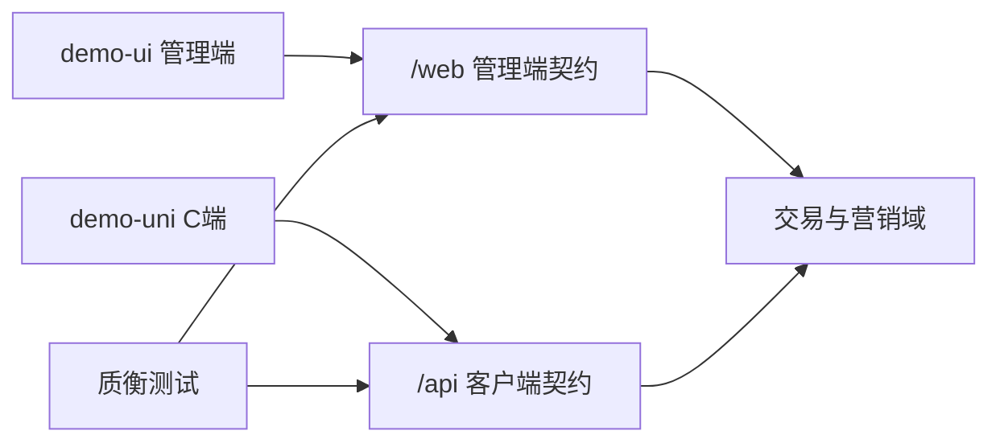

# 商城靶场路线图（前后端联合）

`qualitest-demo-mall` 的**唯一**业务 / 接口 / C 端 uni 交付清单。  
**主路径**：增强已有交易域可测深度，再按需补新域；始终可被质衡测到（双端 JWT、`@api.group`、场景种子、AI 提示）。  
触及客户端 `/api/**` 时：**后端与 `demo-uni` 同批合入**（有屏改屏；没有则本批记缺口，禁止长期双轨）。纯 `/web` 或仅种子、且不影响已接 uni 屏的，可不绑前端。

按**小批次**落地：一次只盯一批。状态：未开始 / 进行中 / 已完成。  
**当前联合批次**：`U2+B1`（只改这里）。

术语：**B\*** = 后端增强；**U\*** = `demo-uni` 屏批次；「uni 跟」= 无独立 U 号，跟本批契约改已有屏。

---

## 1. 定位与现状

### 1.1 定位

| 项 | 说明 |
|---|---|
| 仓库角色 | 质衡联调靶场（默认端口 `8801`，库 `qualitest-demo-mall`） |
| 管理端 | `/web/**` 等 + `demo-ui`（若依风格 CRUD / 场景控制台） |
| 客户端契约 | `/api/**` + 账号 JWT（`POST /api/account/auth/login` → 响应字段 `token`） |
| 认证约定 | 管理端 Token 与客户端 Token **不可混用**；客户端从 Token 取 `accountId` |
| C 端工程 | `demo-uni/`（uni-app Vue3 + Vite + TS）；**勿**塞进 `demo-ui` |

### 1.2 已有业务域

- 账号：注册 / 登录 / 登出 / 资料 / 改密
- 收货地址、余额流水与模拟充值
- 优惠券领取、我的券、下单可用券
- 分类、商品 SPU/SKU、购物车
- 订单：preview / create / pay / cancel / confirmReceive
- 退款：preview / apply / my / cancel
- 进阶：RustFS 文件上传（`/api/file`）

场景种子见 `sql/seed/scenarios/manifest.json`（S01–S08 / F01–F12）；自然语言提示见 [ai-test-flow-prompts.md](./ai-test-flow-prompts.md)。

### 1.3 扩充方向（两手）

1. **增强已有域**（优先）：同一路径上加校验、状态、筛选、幂等与失败场景  
2. **补新域**（按需）：搜索增强、多渠道模拟支付、物流轨迹、评价等（见 §4）



### 1.4 联合分期（一次一批）

**不要并行开两批。** 后端明细见 §3；uni 工程与屏明细见 §6。

| 顺序 | 联合批 | 后端 | 前端（uni） | 合入标准 | 状态 |
|---|---|---|---|---|---|
| 1 | — | （现有 `/api`） | U0 工程骨架 | H5 起得来；请求能打 8801 | 已完成 |
| 2 | — | （现有 `/api`） | U1 登录 + 逛购 | 登录落 token；浏览并选 SKU | 已完成 |
| 3 | **U2+B1** | B1 购物车闭环 | U2 车 + 结算 + 余额支付 | 行为写死 + ≥3 条 S/F；H5 主路径余额下单可演示 | 未开始 |
| 4 | **B2+uni跟** | B2 商品可测（keyword、主图/简介等） | 搜索/详情/列表接新字段；升小版后 `import_apis` 修测流 | 查询/一致性可断言；uni 不再靠占位躲契约 | 未开始 |
| 5 | **U3+B3** | B3 订单门禁 | U3 订单列表/详情/取消/确认（退款可薄） | 状态机可测；订单屏对齐预览 | 未开始 |
| 6 | **U4+B4** | B4 优惠券 | U4 券 + 资料/地址/余额等资产（穿插可并入） | 用券规则可负向；「我的」主能力可点 | 未开始 |
| 7 | **B5+uni跟** | B5 退款链 | 退款申请/列表加厚（可挂 U3 余量或 U5） | 更长退款链可复现 | 未开始 |
| 8 | **B6+uni跟** | B6 模拟支付渠道 | 收银台微信/支付宝示意或接模拟回调 | 回调幂等可测；端上可演示渠道差 | 未开始 |
| — | 穿插 | 账号/地址/余额/文件 | 随 U4 或空档 | 不阻塞上表主序 | 未开始 |
| — | 后置 | 物流/评价/并发等 | U5 店铺/消息/评价示意等 | 主路径通后再开 | 未开始 |

依赖：上表顺序硬；B6 宜在订单支付路径已稳之后；物流/评价依赖发货与确认收货（B3）。预览示意增强见 [c-end-preview-roadmap.md](./c-end-preview-roadmap.md)，不阻塞联合主序。

---

## 2. 落地检查单

合入某联合批前建议核对（可按实际删减）：

1. 表结构变更（若有；init SQL / 变更脚本）  
2. `domain` 与业务内核（写操作不在两端 Controller 各写一份）  
3. 管理端 / 客户端入出参与 API（含 `@api.group`）  
4. 管理端薄页或动作按钮（可选）  
5. seed 场景（成功 / 失败）与 `manifest.json`  
6. [ai-test-flow-prompts.md](./ai-test-flow-prompts.md) 提示条目  
7. Swagger 可测；必要时 README 一句说明  
8. **契约变更才升靶场小版本**（如 `1.0.0` → `1.1.0`）：仅接旧接口不必升。升版后质衡 `import_apis`（按方法+规范化 path upsert）并修测流；推荐自 **B2+uni跟** 起练。空升版测不到「更新接口」。  
9. **同批改 uni**：本批改了已接或本批新接的 `/api`，须同步改 `demo-uni`（或明确不做的屏并记 §6.3）；禁止后端已变、前端长期占位。  
10. uni：`pnpm type-check`；对照预览主按钮/空态/关键字段；演示账号 H5 点通本批路径；无新增硬编码品牌色。  
11. 进度只改正文「当前联合批次」与各表状态列；知识点文按规则写入私有仓（完成含 U\* 的联合批时）。

分层约定见仓库 Cursor 规则 `qualitest-demo-mall-backend`。

---

## 3. 后端能力增强明细

挂在**现有表与 `/api`、`/web`** 上；每项至少补 1 条成功或失败场景 + AI 提示。  
「批次」列对应 §1.4 的 **B\***；做联合批时扫本表该 B 行并按表改 uni。

### 3.1 账号 / 地址 / 余额

| 点 | 建议 | 测试价值 | 批次 | 状态 |
|---|---|---|---|---|
| 登录失败细分 | 密码错误 / 停用以外：空参、错误次数提示（可配置次数） | 负向断言、文案稳定 | 穿插 | 未开始 |
| 资料与头像 | `profile` 可改昵称；头像走 `/api/file` + `bizType=avatar` | 文件 + 账号联动 | 穿插 | 未开始 |
| 改密后旧 Token | 改密使旧客户端 Token 失效（或文档明确仍有效） | 鉴权边界 | 穿插 | 未开始 |
| 地址上限 / 默认互斥 | 最多 N 条；设默认时取消其它默认；删默认地址规则 | 状态机小闭环 | 穿插 | 未开始 |
| 地址校验 | 手机号格式、省市区必填（可先字符串规则） | 参数校验场景 | 穿插 | 未开始 |
| 余额流水筛选 | 已有分页；补类型/时间范围过滤的稳定约定与场景 | 列表查询断言 | 穿插 | 未开始 |
| 充值边界 | `amount≤0`、超大金额拒绝 | 边界值 | 穿插 | 未开始 |

### 3.2 商品 / 分类 / SKU

| 点 | 建议 | 测试价值 | 批次 | 状态 |
|---|---|---|---|---|
| 列表查询增强 | `keyword`、分类、价格/销量排序 | 组合查询 | B2 | 未开始 |
| 详情字段 | 主图/图集（file key）、简介；无图时的空列表约定 | 详情断言 | B2 | 未开始 |
| 库存汇总 | SPU `stock_total` 与 SKU `stock` 写路径一致；下架后不可购 | 数据一致性 | B2 | 未开始 |
| 销量回写 | 支付成功累加 `sales_count`；退款是否回滚写清规则 | 副作用可测 | B2 | 未开始 |
| 管理端批量上下架 | 已有单条 `changeShelfStatus`；可加批量 | 管理端批量操作 | B2（可选） | 未开始 |
| 分类停用 | 停用分类下商品列表不可见或不可加购 | 可见性规则 | B2 | 未开始 |

### 3.3 购物车

| 点 | 建议 | 测试价值 | 批次 | 状态 |
|---|---|---|---|---|
| 同 SKU 合并 | 再次加购累加数量，不新增行 | 幂等/合并 | B1 | 未开始 |
| 加购上限 | 单行数量上限、超库存拒绝（与下单库存规则对齐） | 与 F04 呼应 | B1 | 未开始 |
| 失效行 | 下架/停用 SKU 在「我的购物车」标记不可结算；结算时剔除或整单失败（二选一写死） | 脏数据路径 | B1 | 未开始 |
| 勾选结算 | 行级 `selected`；preview/create 只吃勾选行 | 部分结算 | B1 | 未开始 |
| 数量接口 | 已有改数量；补 `quantity=0` 视为删除或拒绝 | 边界 | B1 | 未开始 |

### 3.4 优惠券

| 点 | 建议 | 测试价值 | 批次 | 状态 |
|---|---|---|---|---|
| 领取库存/名额 | 券总量或每人限领（已有重复领 F12；可加发完） | 库存类负向 | B4 | 未开始 |
| 适用范围 | 全场 / 指定分类或商品（薄实现即可） | 用券失败新场景 | B4 | 未开始 |
| 占券释放 | 关单/超时后券回到可用（S02 已有关单释放；补超时路径） | 与订单联动 | B4（可选） | 未开始 |
| 我的券筛选 | 未用 / 已用 / 过期分状态查询 | 列表过滤 | B4 | 未开始 |
| 多券 | 明确「一单一券」并加「同时传两张」拒绝场景 | 规则文档化 | B4 | 未开始 |

### 3.5 订单 / 支付（字段已有，行为可加深）

订单表已有 `pay_type`（1 微信 2 支付宝 3 余额），当前主路径基本是余额。

| 点 | 建议 | 测试价值 | 批次 | 状态 |
|---|---|---|---|---|
| 订单列表筛选 | 按 `order_status` / 时间；客户端 `my` 已分页则补状态 Tab 约定 | 列表+断言 | B3 | 未开始 |
| 待付款改地址/留言 | 仅待付款可改收货信息或备注 | 状态门禁 | B3 | 未开始 |
| 取消原因 | 必填枚举或长度限制；取消后库存/券释放断言加强 | 副作用 | B3 | 未开始 |
| 支付方式 | 余额路径保持；微信/支付宝走「模拟支付单+回调」（见 §4） | 幂等/回调 | B6 | 未开始 |
| 重复支付 / 已取消再付 | S03/F 类已有；补「已取消订单 pay」拒绝 | 状态机 | B3 | 未开始 |
| 运费规则 | 固定运费已有；可加包邮门槛或多件运费规则（写清公式） | 金额公式断言 | B3（可选） | 未开始 |
| 管理端发货 | `deliver` 可要求运单号（为物流域打底，也可先只存字段） | 管理端必填 | B3（可选） | 未开始 |
| 确认收货门禁 | 非待收货不可确认；完成后不可再确认 | 幂等 | B3 | 未开始 |

### 3.6 退款

| 点 | 建议 | 测试价值 | 批次 | 状态 |
|---|---|---|---|---|
| 退款类型 | 表有「仅退款 / 退货退款」；把退货退款走通（待退货→确认收货→退款） | 更长状态链 | B5 | 未开始 |
| 退款原因枚举 | 固定原因码 + 自定义说明 | 入参校验 | B5 | 未开始 |
| 凭证图 | 申请时可传 file key 列表 | 文件+退款 | B5（可选） | 未开始 |
| 部分退后再退 | 提示集已有；补金额/数量上限算式与场景 ID | 金额精确断言 | B5（可选） | 未开始 |
| 管理端拒绝后再申请 | 拒绝后是否允许再申，写死并测 | 状态回转 | B5 | 未开始 |

### 3.7 文件 / 场景基建

| 点 | 建议 | 测试价值 | 批次 | 状态 |
|---|---|---|---|---|
| bizType 白名单 | `avatar` / `refund` / `product` 等；非法类型拒绝 | 上传负向 | 穿插 | 未开始 |
| 删除权限 | 只能删本人上传；越权 403 | 与 F09 同类 | 穿插 | 未开始 |
| 场景包 | 为本批增强点各加 S/F 场景，避免只改代码无种子 | 可复现 | 随各批 | 未开始 |

进度与顺序以 §1.4 为准；本节是明细，不必再另排一期。

---

## 4. 新域补齐（按需）

建议 B1–B5 告一段落后再开；急需支付幂等场景时可提前开 B6。仍走 §2 检查单。  
B6 先用 HMAC 简单签名即可；要仿真实渠道需等质衡侧能力就绪。

### 4.1 模拟支付 / 履约 / 评价

| 优先级 | 模块 | 建议薄实现 | 批次 | 状态 |
|---|---|---|---|---|
| P0 | 模拟支付渠道 | 支付单 → 成功/失败回调（幂等、重复通知）；与订单 `pay_type` 1/2 对齐 | B6 | 未开始 |
| P1 | 物流轨迹 | `mall_order_shipment` + 轨迹点；客户端时间线；管理端录运单 | 后置（依赖 B3 发货） | 未开始 |
| P1 | 商品评价 | 确认收货后可评；SPU 聚合分 | 后置（依赖 B3 确认收货） | 未开始 |

### 4.2 稳定性与运营（选修）

| 模块 | 建议 | 批次 | 状态 |
|---|---|---|---|
| 库存并发 | 乐观锁 / 预占；失败场景「超卖拦截」 | 后置 | 未开始 |
| 超时关单 | Quartz 关闭待付款 + 释券释库存 | 后置（可与 B4 占券释放一起） | 未开始 |
| 会员积分 / 签到 | 简单积分抵扣 | 后置 | 未开始 |
| 运营工作台 | 管理端待发货 / 待审退款 | 后置 | 未开始 |
| 简单统计 | GMV、退款率等接口 | 后置 | 未开始 |

---

## 5. 边界与非目标

### 5.1 必须遵守

- 保持若依 + JWT 单线；**不**把 Session / HMAC 等异框架 merge 进本仓  
- 新接口带 `@api.group`，并尽量补场景与 AI 提示  
- 仓名与靶场职责不变；对外说明以 README 为准  
- 管理端继续服务运营与场景控制台；**不要**把 `demo-ui` 改成 C 端商城  
- 客户端契约变更须按 §1.4 与 uni 联合合入  

### 5.2 明确不做或长期后置

- 真实微信 / 支付宝商户号与清算（模拟回调即可）  
- 复杂促销引擎、推荐算法、直播、IM 客服（预览仅为站内通知跳转）  
- 不为「看起来更重」而引入 Elasticsearch、分库分表、微服务拆分  
- 不重做整套若依管理端视觉（仅按需增强订单等工作台）  
- 不为「必须有 C 端」而阻塞纯管理端 / 场景种子工作  

---

## 6. C 端 `demo-uni`

工程：[demo-uni/](../demo-uni/)。视觉与交互以 [c-end-ui-preview.html](./c-end-ui-preview.html) 为准；接口对不上时**改接口适配页面**，不把 UI 砍瘦。  
目标：目录分层、主题与配置可集中改；薄而稳，不追求微前端或巨型组件库。

### 6.0 怎么干

| 原则 | 说明 |
|---|---|
| 预览锁交互 | 屏名、主路径、字段形态跟预览；不另发明信息架构 |
| 按屏落地 | UI 按预览复刻 → 有接口就接 → 缺口记 §6.3 或改 `/api` |
| 假数据仅过渡 | 仅骨架或后端未就绪示意；接真后删，禁止长期双轨 |
| 造数不归客户端 | 场景仍走 `POST /web/test/scenario/load/{id}` 或 SQL |
| 演示账号 | `13800000001` / `Test@123456` |
| 联调 | `baseUrl` 默认 `http://localhost:8801`；Bearer 客户端 token |
| 多端节奏 | 一套代码写 H5/小程序/App；日常主调 **H5**；登录/支付/分享再抽验小程序 |

主路径：登录 → 首页/分类/搜索 → 详情 SKU → 购物车 → 结算 → 支付 → 订单。

### 6.1 视觉约定

与管理端若依皮肤脱钩。

| Token | 值 | 说明 |
|---|---|---|
| 品牌 | 衡物 | 精选日用；可改名，但全仓统一 |
| brand | `#2F6F5E` | 松绿；主按钮 / Tab 选中 / 品牌头 |
| price | `#E24B3B` | 商城红；价格与角标 |
| bg | `#F5F5F5` | 灰底 |
| surface | `#FFFFFF` | 卡片 / 条 |
| ink | `#1A1A1A` | 主文字 |
| radius | `10` | 卡片与控件圆角 |

Banner / 秒杀 / 评价 / 店铺 / 物流等可先示意，接口后补。

### 6.2 工程化基线（U0 已落齐）

| 层 | 选型 | 说明 |
|---|---|---|
| UI | [wot-design-uni](https://wot-ui.cn/)（`wd-*`） | Vue3 + TS；CSS 变量改主题 |
| 状态 | Pinia 2.x | `user` / `cart` 等跨页态 |
| 请求 | 自研薄封装 `uni.request` | 泛型解包、Bearer、401；不上 axios |
| 时间 | dayjs（按需） | 订单时间等 |
| 业务组件 | 自研薄层 | `ProductCard`、`SkuSheet`、`AppPrice`、`ProductListRow` 等 |
| 通用控件 | 用 wot | Button、Form、Popup、Tabs、Empty… |

**不上**：整仓换 unibest、UnoCSS 先行、过早 i18n / E2E、并行再引 uview。

目录约定：

```text
demo-uni/src/
  api/           # 按域：auth / product / cart / order / account …
  types/         # 请求响应与页面类型
  stores/        # Pinia
  components/    # 商城业务组件；通用用 wd-*
  pages/         # 路由页：组组件 + 调 store/api
  composables/   # 分页、倒计时等
  utils/         # request、storage、format、navigate
  constants/     # 存储 key、路由 path
  config/        # 品牌名、slogan
```

| 层 | 职责 | 禁止 |
|---|---|---|
| `pages/` | 拼屏、生命周期 | 拼完整 URL、硬编码品牌色 |
| `components/` | 商城展示与轻交互 | 调具体业务 API；重复造 wot 控件 |
| `api/` | path、method、入参出参 | toast、跳转、写 storage |
| `stores/` | 跨页态 | 纯 UI 临时态硬塞全局 |
| `utils/request` | baseURL、Bearer、码表、401 | 业务字段映射 |

配置面：品牌 → `config/app.ts`；色板 → `uni.scss` + `App.vue` CSS 变量（勿再拆文件 `@import`）；环境 → `.env*` 的 `VITE_API_BASE_URL`。  
合入前 `pnpm type-check`；密钥不进仓。

### 6.3 页面清单与接口适配

状态指 **uni 工程**。Tab：首页 / 分类 / 购物车 / 我的。

| 页面 / 能力 | 现有接口（若有） | 拟改 / 拟增 | 状态 |
|---|---|---|---|
| 登录 / 注册（App/H5） | 密码登录等 | 协议勾选；验证码/OAuth 可后置 | 预览已有 / uni 密码已接 |
| 登录（微信小程序） | 手机号/短信 | 独立页；延后 | 预览已有 / uni 延后 |
| 首页 | `mallCategory/enabled`、`mallProduct/list` | 价格/已售；标签后置 | uni 已接 |
| 分类 | 同上 | 按分类筛选 | uni 已接 |
| 搜索 | `list` + `productName` | B2 起接 `keyword` | uni 已接（productName） |
| Banner / 秒杀 | — | 示意 | uni 示意 |
| 详情 + SKU | `.../detail` | B2 主图/简介；加购随 U2 | uni SKU 已接（主图占位） |
| 购物车 | `mallCart/my*` | 与 B1 失效/勾选一致 | uni 未开始 |
| 结算 / 下单 / 收银台 / 成功页 | preview/create/pay 等 | 余额优先；渠道随 B6 | uni 未开始 |
| 订单列表 / 详情 / 取消 / 确认 | `mallOrder/my*` 等 | 与 B3 门禁一致 | uni 未开始 |
| 退款申请 / 列表 | `mallOrderRefund/*` | 与 B5 加厚 | uni 未开始 |
| 地址 / 券 / 余额 / 资料 / 改密 / 协议 | 对应 account/auth | 随 U4+B4 / 穿插 | uni 未开始 |
| 物流 / 店铺 / 评价 | — | 后置或示意 | 未开始 / 示意 |

### 6.4 uni 屏明细（按 U\*）

做某联合批时只扫对应行。

#### U0 · 工程骨架（已完成）

目录骨架、`@/` 别名、品牌 config、设计 token、wot、request、Pinia user、env/proxy、三 Tab 壳、业务组件壳、清 Hello —— 已完成。（分类已升为第四 Tab，见 U1。）

#### U1 · 登录 + 逛购（已完成）

| 点 | 接口 | 状态 |
|---|---|---|
| App/H5 密码登录 | `POST /api/account/auth/login` | 已完成 |
| 小程序登录 | — | 延后 U5 |
| 首页 / 分类 Tab / 搜索 / 详情+SKU / ProductCard | category/product | 已完成 |

#### U2 · 车 + 结算 + 付（联合批 U2+B1）

| 点 | 接口 | 状态 |
|---|---|---|
| 购物车；结算；下单；余额收银台；成功页 | `mallCart` / `mallOrder` / 充值 | 未开始 |

#### U3 · 订单与售后（联合批 U3+B3）

| 点 | 接口 | 状态 |
|---|---|---|
| 订单列表/详情；取消/确认；退款可薄；物流可占位 | `mallOrder` / refund | 未开始 |

#### U4 · 我的资产（联合批 U4+B4）

| 点 | 接口 | 状态 |
|---|---|---|
| 资料；改密；地址；券；余额/提现；协议静态页 | profile / address / coupon / balance | 未开始 |

#### U5 · 收尾与选修（后置）

店铺、消息、评价示意、空态、渠道差、商家入口、预览 C 批搬迁 —— 未开始。

### 6.5 商家端（单账号双端 · 移动）

预览：[merchant-ui-preview.html](./merchant-ui-preview.html)。与 C 端同账号；从「我的 → 商家中心」进入。平台审核仍归 `demo-ui`。本阶段不建商家前端工程；联调时再补接口。

| 页面 / 能力 | 状态 |
|---|---|
| 入驻申请 / 审批 / 工作台 / 商品 / 发货 / 退款 / 店铺资金 / 消息 | 预览已有 / 后端未开始 |

---

## 7. 相关文档

- 快速启动与认证：[../README.md](../README.md)  
- Compose 部署：[deploy.md](./deploy.md)  
- AI 测试流提示：[ai-test-flow-prompts.md](./ai-test-flow-prompts.md)  
- C 端预览：[c-end-ui-preview.html](./c-end-ui-preview.html)  
- 预览示意增强：[c-end-preview-roadmap.md](./c-end-preview-roadmap.md)  
- 商家预览：[merchant-ui-preview.html](./merchant-ui-preview.html)  
- 场景元数据：`../sql/seed/scenarios/manifest.json`  
- 后端双契约分层：仓库 Cursor 规则 `qualitest-demo-mall-backend`  
